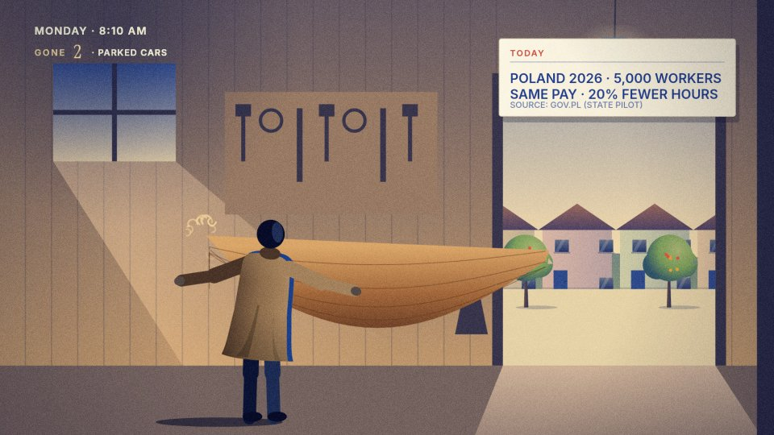

# Scenario: run a documentary YouTube channel with Claude

This repository is the complete production system behind **[The Good Takeoff](https://www.youtube.com/@thegoodtakeoff)**,
a YouTube channel that publishes one animated documentary (8–12 minutes, English) every day about superintelligence
and how the transition can go well for everybody.

Research, fact-checking, script, animation, voice, thumbnails and upload all run with Claude. A human stays in the loop
at four approval stops. Everything that made the channel work is in here: the rules, the Claude skills, the tools and the
full source of every film. It is open so that anyone can start a channel like this one.


*A frame from film #74 "Your Life in 2050 If We Get AI Right", rendered straight from `films/74-your-life-in-2050/code`.*

## Results so far

| | |
|---|---|
| First film | 19 Oct 2026 |
| Long-form films published | 36, plus 12 scheduled and 1 in production (26 Nov 2026) |
| Channel views | 757,053 |
| Subscribers | 5,210 |
| Monetised (YouTube Partner Program) | 17 Nov 2026, four weeks after the first upload |

Numbers from the YouTube Data API on 26 Nov 2026. The full film list with links and dates is in [`README.de.md`](README.de.md#die-filme)
and [`films/filme.json`](films/filme.json).

## How a film is made

```
 topic + title ──► core idea ──► outline ──► research ──► script + thumbnails ──► fact-check ──► voice + animation ──► preview ──► upload + A/B test
     STOP 1          STOP 2                                    STOP 3                                                 STOP 4
```

| # | Step | What Claude does | Building block |
|---|---|---|---|
| 1 | **Topic + title** | Checks demand (≥100k views for the niche in ~30 days), writes title options with reasoning | skill [`good-takeoff-thema-titel`](regeln/skills/good-takeoff-thema-titel/SKILL.md), [`regeln/treffer-check.md`](regeln/treffer-check.md) |
| 2 | **Outline** | A chain of questions with a hook in the first 60 seconds and a payoff at the end | [`regeln/hook-bauplan.md`](regeln/hook-bauplan.md), [`regeln/REGELN.md`](regeln/REGELN.md) §3–4 |
| 3 | **Research** | Fact sheet with primary sources, 3–6 real interview clips (≤10 % of runtime) | [`regeln/clip-schritt.md`](regeln/clip-schritt.md) |
| 4 | **Script** | Writer and critic in separate passes, banned-phrase list, payoff check, listening version | skill [`scenario-script`](regeln/skills/scenario-script/SKILL.md), [`tools/regel_check.py`](tools/regel_check.py) |
| 5 | **Fact-check** | Every claim gets a traffic light (green/yellow/red) with a second, independent checker | `films/NN-*/skript/faktencheck*.md`, `ampelseite.md` |
| 6 | **Animation** | Every scene is code (Canvas 2D, rendered frame by frame to ffmpeg). One picture per sentence, 60–70 % explainer graphics | skills [`scenario-motion`](regeln/skills/scenario-motion/SKILL.md), [`world-class-motion-design`](regeln/skills/world-class-motion-design/SKILL.md), [`motion-director-gates`](regeln/skills/motion-director-gates/SKILL.md), [`fluid-motion-design`](regeln/skills/fluid-motion-design/SKILL.md), [`stil/`](stil/) |
| 7 | **Voice + sound** | ElevenLabs voice via fal, forced alignment for word timing, music and SFX cues, subtitles | `films/NN-*/code/audio/` (`build_vo.py`, `align_ps.py`, `mix.py`, `subs.py`) |
| 8 | **Thumbnails** | Three variants A/B/C in one illustration style, checked at phone size | skill [`good-takeoff-thumbnails`](regeln/skills/good-takeoff-thumbnails/SKILL.md), [`tools/thumbnails/`](tools/thumbnails/) |
| 9 | **Upload** | YouTube Data API upload, scheduled 17:00 Vienna, description check, Test & Compare for titles and thumbnails | skill [`good-takeoff-upload`](regeln/skills/good-takeoff-upload/SKILL.md), [`tools/check_descriptions.py`](tools/check_descriptions.py) |
| 10 | **Learn** | Weekly analytics review, at most three changes for the next batch, written back into the rules | skill [`wochenanalyse`](regeln/skills/wochenanalyse/SKILL.md), [`tools/yt_analytics.py`](tools/yt_analytics.py), [`kanalanalyse/`](kanalanalyse/) |

The four human stops: (1) topic and title, with research and a market check, (2) the core idea of the film,
(3) a listening version of the script together with the three thumbnails, (4) the preview of the finished film.
Between the stops Claude works on its own; after stop 3 it builds the whole film in one go.

The rules file [`regeln/REGELN.md`](regeln/REGELN.md) is the heart of the system. Every lesson from a published film
(retention dips, click rates, feedback) is written into it with a date, so the next film starts smarter.
See [`docs/building-blocks.md`](docs/building-blocks.md) for an index of every reusable part.

## Start your own channel

### What you need

- A Claude plan with Claude Code (the channel was built in Claude Code on the web and the desktop app)
- Node.js 20+, Python 3.11+, ffmpeg
- A YouTube channel and a Google Cloud OAuth client with the YouTube Data API v3 enabled
- A [fal.ai](https://fal.ai) key for the voice (ElevenLabs via fal) and, optionally, music and images

### Setup

```bash
git clone https://github.com/kobenstein/scenario.git
cd scenario
cp .env.example .env          # fill in your own keys, never commit this file
set -a; source .env; set +a   # load them into your shell (or put them into your Claude Code environment)
npm install
python3 -m pip install numpy
```

Check that the reference film renders on your machine (no keys needed, it uses provisional timing):

```bash
cd films/74-your-life-in-2050/code
npm install
node render.mjs --snap 5,60 --dir snaps --scale 0.5    # writes two stills
node render.mjs --out preview.mp4 --from 0 --to 20 --scale 0.5
```

### Make your first film

1. **Make the system yours.** Read [`regeln/REGELN.md`](regeln/REGELN.md) and [`regeln/vibe-brief.md`](regeln/vibe-brief.md),
   then rewrite §1 (the channel's stance) and the style in [`stil/`](stil/) for your topic. Add the skills from
   [`regeln/skills/`](regeln/skills/) to Claude and rename them for your channel.
2. **Copy the template.** `cp -r template/film films/01-your-title` and follow [`template/film/README.md`](template/film/README.md).
3. **Ask Claude for stop 1.** For example: *"Use the thema-titel skill and give me three topics with titles for the first film."*
4. **Go through the stops.** Outline, research, script, listening version, thumbnails. Approve each one.
5. **Build.** Start from the code of the reference film [`films/74-your-life-in-2050/code`](films/74-your-life-in-2050/code)
   and replace the scenes. Render, check the contact sheet, mix, render the master.
6. **Upload.** Use the upload skill or [`tools/`](tools/) with your OAuth client. Schedule it, then set up Test & Compare in YouTube Studio.

Most of the working notes, rules and skills are written in German, because the channel was run in German and published in English.
Claude reads them fine in any language. Translations are welcome, see [CONTRIBUTING.md](CONTRIBUTING.md).

## What is in this repo

```
films/      one folder per film: NN-title/ skript/ · code/ · verpackung/   (the channel's films, kept as worked examples)
template/   an empty film folder to start from
regeln/     the rules (REGELN.md first) and all Claude skills of the channel
stil/       the visual style "Editorial Night" and the style tests it came from
tools/      check, render, upload, analytics, dubbing and Shorts tools
kanalanalyse/  channel analyses and competitor notes
docs/       building-block index and images
```

Everything under `films/` is the real material of The Good Takeoff. It stays here as a worked example of every step,
including the dead ends. Names, links and the channel's stance in it are specific to that channel.

## What is not in this repo

- **No secrets.** All keys live in environment variables (see [`.env.example`](.env.example)).
- **No third-party media.** Interview clips, press photos and source PDFs are not included; the films list where they came from.
- **No files over 1 MB.** Masters, audio, music and large images live in Google Drive and on an external drive.
- Some film code reads audio and timing from a working folder (`/mnt/project-files/scenario/…`). To re-render a film with
  its real voice you need to rebuild the audio first; without it, films fall back to provisional timing where available.

## License

Code, rules, skills and scripts are released under the [MIT License](LICENSE). The channel name "The Good Takeoff",
its logo and the published videos are not part of the license.

Deutsche Kurzfassung und Filmtabelle: [README.de.md](README.de.md).
